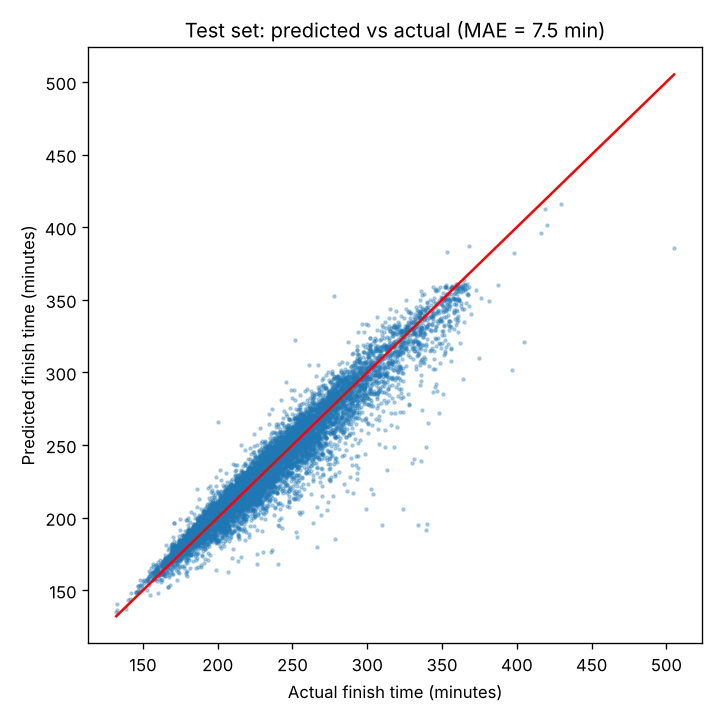

# Boston Marathon Finish Time Predictor

AIPI 510 Module Project 3 (Data/ML Engineering)

Team: Caleb McNeill, Justin Winkler, Ben Dushnitzky

- **API:** TODO (Cloud Run link goes here once it's deployed)

## Overview

You're halfway through a marathon. What time are you going to finish in? Most runners
just double their halfway time, but almost everybody slows down in the second half, so
that guess is usually too fast.

This project predicts a runner's finish time from their age, gender and their times at
the 5K, 10K and halfway checkpoints. The model itself is simple. The main goal was to
build the whole pipeline around it:

1. Clean the data and host it in the cloud (Google Cloud Storage)
2. Train a model with a pipeline that is controlled by `config.yaml`
3. Track the runs with MLflow
4. Put everything in a Docker image
5. Serve the model as an API (FastAPI) and deploy it on Google Cloud Run
6. Build a front-end (Streamlit) that calls the deployed API

## Dataset

We used [Finishers Boston Marathon 2015, 2016 & 2017](https://www.kaggle.com/datasets/rojour/boston-results)
from Kaggle. It has one row per finisher for each of the three years (79,638 rows in
total) with the runner's name, age, gender, city, their split times every 5K, and their
official finish time. The data was scraped from the official Boston Marathon results
site by the Kaggle author. Kaggle lists the license as "Unknown".

**Cleaning** (`src/clean_data.py`):

- Combined the three years by column name, because the files don't have exactly the same columns
- Kept only age, gender, the 5K / 10K / half splits and the finish time
- Dropped the columns that are calculated from the finish time (pace, projected time, overall / gender / division place), because they would give the answer away
- Dropped the splits after halfway, since we predict from the halfway point
- Converted all times from text like `1:45:30` to minutes
- Dropped 354 rows that were missing a split (shown as `-` in the raw files)
- Replaced each runner's name with a number (`runner_id`), so the cleaned file has no names, bib numbers or cities in it

The cleaned file has 79,284 rows and 67,427 different runners.

| Column | What it is |
|---|---|
| `runner_id` | A number for each runner (same person = same number across years) |
| `year` | Race year (2015, 2016 or 2017) |
| `age` | Age on race day |
| `gender` | `M` or `F` |
| `split_5k`, `split_10k`, `split_half` | Time at each checkpoint, in minutes |
| `finish_time` | Official finish time in minutes (**this is the target**) |

## Project structure

```
config.yaml            # all the settings for the pipeline
requirements.txt       # packages for training and the API
Dockerfile             # trains the model and serves the API
src/
  clean_data.py        # raw Kaggle files -> cleaned file (run once)
  download_data.py     # downloads the cleaned file from Google Cloud Storage
  features.py          # feature engineering, shared by training and the API
  train.py             # the training pipeline (logs to MLflow)
  api.py               # FastAPI app with the /predict endpoint
```

## Model and evaluation

**Task:** regression. **Target:** finish time in minutes. **Main metric:** mean absolute
error (MAE), because "off by X minutes on average" is easy to understand. We also
report RMSE and R².

**Features:** age, gender, 5K split, 10K split, half split, and one feature we made
called `slowdown`. It's the runner's pace from 10K to halfway minus their pace over the
first 10K. If it's positive, they were already slowing down before halfway.

**Model:** a scikit-learn `Pipeline` with two steps: one-hot encoding for gender, then a
random forest (100 trees, max depth 10). The preprocessing and the model are saved
together as one file, so the API uses the exact same preprocessing as training. You can
switch to linear regression by changing `model.type` in `config.yaml`.

**Split:** 70% train, 15% validation, 15% test. About 1 in 7 runners is in the data more
than once because they ran in more than one year. We split by runner instead of by row,
so the same person is never in both the training and test sets.

**Results:**

| Model | Validation MAE | Test MAE | Test RMSE | Test R² |
|---|---|---|---|---|
| Baseline: double the half split | | 14.98 min | | |
| Linear regression | 7.84 min | 7.82 min | 11.78 | 0.921 |
| **Random forest (deployed)** | 7.54 min | 7.50 min | 11.33 | 0.926 |

The model is off by about 7.5 minutes on average. That's about half the error of just
doubling your halfway time, mostly because the model learned that people slow down in
the second half. The random forest is only a little better than plain linear regression.



The plot shows the model does well for most runners but misses the ones who slow down
a lot late in the race (the points well below the red line). It can't see that coming
from the first half alone.

## Cloud services

| Service | What we use it for |
|---|---|
| Google Cloud Storage | Hosts the cleaned data file. The pipeline downloads it from there. |
| Google Cloud Build | Builds the Docker image when we deploy |
| Google Cloud Run | Runs the API container and gives it a public URL |

## How to run it

You need Python 3.11. Run all the commands from the main folder of the repo.

### 1. Install the packages

```bash
pip install -r requirements.txt
```

### 2. Train the model

```bash
python src/train.py
```

This downloads the cleaned data from our Google Cloud Storage bucket (the file is
public, so you don't need a Google Cloud account), trains the model, prints the
metrics, and saves the model to `models/model.joblib`. The settings (features, split
sizes, random seed, model type and its parameters) all come from `config.yaml`.

### 3. Look at the runs in MLflow

Every training run is logged to MLflow: the parameters, the metrics, the config file,
the predicted vs actual plot and the model itself.

```bash
mlflow ui --backend-store-uri sqlite:///mlflow.db
```

Then open http://localhost:5000.

### 4. Run and test the API locally

```bash
uvicorn api:app --app-dir src --port 8080
```

(`--app-dir src` just tells uvicorn that the code is in the `src` folder.)

In another terminal:

```bash
curl -X POST http://localhost:8080/predict \
  -H "Content-Type: application/json" \
  -d '{"age": 35, "gender": "F", "split_5k": 25.5, "split_10k": 51, "split_half": 108}'
```

All times are in minutes. You should get back:

```json
{"predicted_finish_minutes": 224.6, "predicted_finish_time": "3:44:38", "typical_error_minutes": 7.5}
```

You can also open http://localhost:8080/docs to try it in the browser.

### 5. Run it with Docker

```bash
docker build -t marathon-api .
docker run -p 8080:8080 marathon-api
```

Building the image downloads the data and trains the model, so the image always has a
trained model inside. Running it starts the API on port 8080, and you can test it with
the same curl command as above.

To run just the training step in a container:

```bash
docker run marathon-api python src/train.py
```

### 6. Deploy the API to Google Cloud Run

You need a Google Cloud project with billing turned on and the
[gcloud CLI](https://cloud.google.com/sdk/docs/install) (or use Cloud Shell in the
browser, which already has it).

```bash
gcloud run deploy marathon-api --source . --region us-east1 --memory 1Gi --allow-unauthenticated
```

This builds the Dockerfile with Cloud Build and deploys it. When it's done it prints
the service URL. Test it the same way as before:

```bash
curl -X POST https://YOUR-SERVICE-URL/predict \
  -H "Content-Type: application/json" \
  -d '{"age": 35, "gender": "F", "split_5k": 25.5, "split_10k": 51, "split_half": 108}'
```

## How the data got into the cloud

This only had to be done once.

1. Download the three CSV files from Kaggle and put them in `data/raw/`
2. Clean them: `python src/clean_data.py` (this creates `data/boston_clean_v1.csv`)
3. Create a bucket, upload the cleaned file, and make it readable by anyone:

```bash
gcloud storage buckets create gs://aipi510-boston-marathon --location=us-east1
gcloud storage cp data/boston_clean_v1.csv gs://aipi510-boston-marathon/
gcloud storage buckets add-iam-policy-binding gs://aipi510-boston-marathon \
  --member=allUsers --role=roles/storage.objectViewer
```

We only uploaded the cleaned file, which has no names in it. The raw files with names
are not in the bucket or in this repo.
