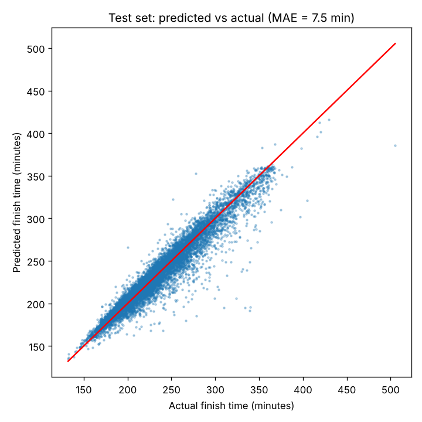

# Boston Marathon Finish Time Predictor

AIPI 510 Module Project 3 (Data/ML Engineering)

Team: Caleb McNeill, Justin Winkler, Ben Dushnitzky

- **Front-end app:** https://boston-marathon-predictor.streamlit.app
- **API:** https://marathon-api-338903196905.us-east1.run.app ([try it in the browser](https://marathon-api-338903196905.us-east1.run.app/docs))

## Overview

You're halfway through a marathon. Now you want to know what time you will finish in.
A rule of thumb suggests runners simply double their first half-marathon split to get a 
guess, but late-race blunders in nutrition, hydration, and pacing make this estimate 
optimistic for many.

This project predicts a runner's finish time from their age, gender and their times at
various race checkpoints. The model itself is simple. The main goal was to build the 
whole pipeline around it:

1. Clean the data and host it in the cloud (Google Cloud Storage)
2. Train a model with a pipeline that is controlled by `config.yaml`
3. Track the runs with MLflow
4. Put everything in a Docker image
5. Serve the model as an API (FastAPI) and deploy it on Google Cloud Run
6. Build a front-end (Streamlit) that calls the deployed API

## Dataset

We used [Finishers Boston Marathon 2015, 2016 & 2017](https://www.kaggle.com/datasets/rojour/boston-results)
from Kaggle. It has one row per finisher for each of the three years (79,638 rows in
total) with the runner's name, age, gender, city, their split times every 5K, and their
official finish time. The data was scraped from the official Boston Marathon results
site by the Kaggle author. Kaggle lists the license as "Unknown" [3].

**Cleaning** (`src/clean_data.py`):

- Combined the three years by column name, because the files don't have exactly the same columns
- Kept only age, gender, the 5K / 10K / half splits and the finish time
- Dropped the columns that are calculated from the finish time (pace, projected time, overall / gender / division place), because they would give the answer away
- Dropped the splits after halfway, since we predict from the halfway point or earlier
- Converted all times from text like `1:45:30` to minutes
- Dropped 354 rows that were missing a split (shown as `-` in the raw files)
- Replaced each runner's name with a number (`runner_id`), so the cleaned file has no names, bib numbers or cities in it

The cleaned file has 79,284 rows and 67,427 different runners [3].

| Column | What it is |
|---|---|
| `runner_id` | A number for each runner (same person = same number across years) |
| `year` | Race year (2015, 2016 or 2017) |
| `age` | Age on race day |
| `gender` | `M` or `F` |
| `split_5k`, `split_10k`, `split_half` | Time at each checkpoint, in minutes |
| `finish_time` | Official finish time in minutes (**this is the target**) |

## Project structure

```
config.yaml            # all the settings for the pipeline
requirements.txt       # packages for training and the API
Dockerfile             # trains the model and serves the API
src/
  clean_data.py        # raw Kaggle files -> cleaned file (run once)
  download_data.py     # downloads the cleaned file from Google Cloud Storage
  features.py          # feature engineering, shared by training and the API
  train.py             # the training pipeline (logs to MLflow)
  api.py               # FastAPI app with the /predict endpoint
app/
  streamlit_app.py     # front-end that calls the deployed API
  requirements.txt     # packages for the front-end
```

## Model and evaluation

**Task:** regression. **Target:** finish time in minutes. **Main metric:** mean absolute
error (MAE), because "off by X minutes on average" is easy to understand. We also
report RMSE and R².

**Features:** age, gender, 5K split, 10K split, half split, and one feature we made
called `slowdown`. It's the runner's pace from 10K to halfway minus their pace over the
first 10K. If it's positive, they were already slowing down before halfway.

**Four models, one for each set of times a runner knows.** Not everyone (or the friend
tracking them) knows all three checkpoint times, so besides the main model we train three
more that each use only one split:

| Model | Features | Used when the runner gives us |
|---|---|---|
| `all_splits` | age, gender, 5K, 10K, half, `slowdown` | all three splits |
| `half_only` | age, gender, half | the half split, but not all three |
| `10k_only` | age, gender, 10K | the 10K split, but not the half |
| `5k_only` | age, gender, 5K | only the 5K split |

The API picks the model from the splits in the request. If a runner gives two splits, it
uses the model for the later one and ignores the earlier one. The single-split models
don't get `slowdown`, because it needs two splits. Everything else (the pipeline, the
random forest settings, the data split) is the same for all four. The feature lists are
in `config.yaml`.

**Model:** a scikit-learn `Pipeline` with two steps: one-hot encoding for gender, then a
random forest (100 trees, max depth 10). The preprocessing and the model are saved
together as one file, so the API uses the exact same preprocessing as training. You can
switch to linear regression by changing `model.type` in `config.yaml`.

**Split:** 70% train, 15% validation, 15% test. About 1 in 7 runners appears in the data 
more than once because they ran in more than one year. We split by runner instead of by 
row, so the same person is never in both the training and test sets.

**Results:**

| Model | Validation MAE | Test MAE | Test RMSE | Test R² |
|---|---|---|---|---|
| Baseline: double the half split | | 14.98 min | | |
| Linear regression | 7.84 min | 7.82 min | 11.78 | 0.921 |
| **Random forest (deployed)** | 7.54 min | 7.50 min | 11.33 | 0.926 |

The model is off by about 7.5 minutes on average. That's about half the error of just
doubling your halfway time, mostly because the model learned that people slow down in
the second half. The random forest is only a little better than plain linear regression.

The single-split models (all random forests), next to the main one. Each baseline is
"keep the pace you had at that checkpoint all the way to the finish", which for the half
split is the same as doubling it:

| Model | Validation MAE | Test MAE | Test RMSE | Test R² | Baseline test MAE |
|---|---|---|---|---|---|
| `all_splits` | 7.54 min | 7.50 min | 11.33 | 0.926 | 14.98 min |
| `half_only` | 8.85 min | 8.87 min | 12.83 | 0.906 | 14.98 min |
| `10k_only` | 12.35 min | 12.31 min | 17.04 | 0.834 | 19.03 min |
| `5k_only` | 14.15 min | 14.02 min | 19.34 | 0.786 | 19.87 min |

The earlier the checkpoint, the bigger the error, which makes sense: at 5K there are
still 37 km left to go wrong. Every model still beats its baseline by about 6 to 7
minutes. All four are tested on the same runners, so we could compare them runner by
runner: resampling the test runners 1,000 times, the 95% interval for each model's
improvement over its baseline is at most 0.4 minutes wide and nowhere near zero (for
example 5.6 to 6.1 minutes for `5k_only`). The app shows each model's own test MAE as
its "give or take", so a prediction from the 5K time alone is shown as less certain
than one from all three splits.

**Why we don't report AIC.** AIC scores a model on how well it fits minus a penalty for
how many parameters it has, so we tried it as a secondary metric to see what the extra
features cost the main model. We left it out for three reasons:

- The penalty is too small to matter. It is twice the number of feature columns: 14 for
  `all_splits` and 8 for each single-split model. On our 55,522 training rows the AIC
  scores themselves were about 20,000 or more apart, so a difference of 6 can't change
  any conclusion.
- After further research, we realized it isn't well defined for a random forest. AIC needs a count of the model's parameters,
  which random forest models don't have. Counting features only makes sense for linear 
  regression.



The plot shows the model does well for most runners but misses the ones who slow down
a lot late in the race (the points well below the red line). It can't see that coming
from the first half alone.

## Limitations

- **The data is only from the Boston Marathon, and most Boston runners had to qualify.**
  About 80% of the field qualified by running another marathon faster than a standard set by the Boston Athletic Association each year. The runners in our data are faster and better trained for the distance than the typical marathoner, so the predictions are likely too fast for an average runner [3].
- **Three race days on one course.** The data only covers 2015, 2016 and 2017 [3], so the model has seen just three days of weather and can't tell a hot year from a cool one. Every race was also on Boston's course, so the predictions may not carry over to a course with different hills. Also, the model has no information about changes to the course over the years, such as construction or route adjustments which are common in urban marathons.
- **The races were run before "supershoes" and newer fueling strategies became common.**
  Both have made runners more efficient late in the race, which is exactly the part our model predicts. The model learned the late-race slowdown of 2015-2017 runners, so for today's runners its predictions may be too slow.
- **We only know what the race organizers chose to record.** The only personal details in the results are age, gender, and where the runner is from, and we use just age and gender. Things that matter a lot for a finish time, like training volume or how many marathons someone has run, were never collected, so the model can't use them.
- **Gender is only recorded as M or F.** The app and the API can only offer those two options because that's all the data has from these years of the Boston Marathon. Perhaps future data collection could include more inclusive gender options giving more insight into the performance of individuals who choose to specify other gender identities.
- **The model assumes continuous race execution.** It does not account for interruptions during the race, such as bathroom breaks or injuries. Interruptions, especially after the half-marathon point, can significantly affect finish times, but the model has no way to know about them. 
- **The model does not account for starting in a denser wave of runners.** Crowding at the start may affect a runner's pace, but the model has no information about it.
The Boston Marathon traditionally starts with four waves [1], and runners may experience congestion after the start, especially in the early miles. The model has no information about which wave a runner started in, so it cannot account for this effect. Future years of the race are expected to introduce more waves of more runners, which could alleviate congestion for some waves of runners [1].

## Ethics

- **The dataset's license is unknown.** Kaggle lists the license as "Unknown" [3]. The Kaggle author scraped the results from the official Boston Marathon results site, and we don't know whether the site's terms of service or `robots.txt` allowed that [2]. We can't say for sure that we have the right to reuse or share this data. We don't share the raw files, but we do host a cleaned version of them in a public bucket.
- **The runners didn't agree to be in this project.** The raw files have each runner's name, bib number, city, state and country [3]. Race results are public, but the runners were never asked about being used to train a model.
- **The cleaned data has no names, but it isn't truly anonymous.** We replaced names
  with a number and dropped bib numbers and locations. The cleaned file still has each runner's age, gender, race year and exact times, and those could be matched back to the public results to find out who a row belongs to [3].
- **Gender is only M or F.** That's all the results record [3], so the app can't serve runners who don't fit either option. The model's interpretation of gender is therefore limited to the binary M/F interpretation of self-registered entries of runners. The Boston Athletic Association would need to update its data collection practices to include more inclusive gender options.
- **The app is for fun and educational purposes.** A prediction shouldn't be used to make decisions about health, training or pacing during a race. We note this on the app (see "About this prediction").

## Cloud services

| Service | What we use it for |
|---|---|
| Google Cloud Storage | Hosts the cleaned data file. The pipeline downloads it from there. |
| Google Cloud Build | Builds the Docker image when we deploy |
| Google Cloud Run | Runs the API container and gives it a public URL |
| Streamlit Community Cloud | Hosts the front-end app |

## How to run it

You need:

- [Python](https://www.python.org/downloads/) 3.12 or greater
- [Docker](https://docs.docker.com/get-started/get-docker/), for step 5 (on Windows and
  Mac, Docker Desktop)
- On Windows, [WSL](https://learn.microsoft.com/en-us/windows/wsl/install) (Windows
  Subsystem for Linux). The commands below are written for a Linux or Mac terminal, so
  run them inside WSL.

Run all the commands from the main folder of the repo.

### 1. Install the packages

```bash
pip install -r requirements.txt
```

### 2. Train the model

```bash
python src/train.py
```

This downloads the cleaned data from our Google Cloud Storage bucket (the file is
public, so you don't need a Google Cloud account), trains the model, prints the
metrics, and saves each of the four models in its own folder, like
`models/all_splits/model.joblib`. The settings (data version, features for each model,
split sizes, random seed, model type and its parameters) all come from `config.yaml`.

### 3. Look at the runs in MLflow

Every training run is logged to MLflow, one run for each of the four models: the
parameters (including which data version and which features it used), the metrics, the
config file, the predicted vs actual plot and the model itself.

```bash
mlflow ui --backend-store-uri sqlite:///mlflow.db
```

Then open http://localhost:5000.

### 4. Run and test the API locally

```bash
uvicorn api:app --app-dir src --port 8080
```

(`--app-dir src` just tells uvicorn that the code is in the `src` folder.)

In another terminal:

```bash
curl -X POST http://localhost:8080/predict \
  -H "Content-Type: application/json" \
  -d '{"age": 35, "gender": "F", "split_5k": 25.5, "split_10k": 51, "split_half": 108}'
```

All times are in minutes. You should get back:

```json
{"predicted_finish_minutes": 224.6, "predicted_finish_time": "3:44:38", "typical_error_minutes": 7.5,
 "model_used": "all_splits", "splits_used": ["split_5k", "split_10k", "split_half"]}
```

The three splits are optional, but you have to send at least one. Leave out the ones you
don't know and the API uses the model that fits:

```bash
curl -X POST http://localhost:8080/predict \
  -H "Content-Type: application/json" \
  -d '{"age": 35, "gender": "F", "split_10k": 51}'
```

```json
{"predicted_finish_minutes": 229.5, "predicted_finish_time": "3:49:27", "typical_error_minutes": 12.31,
 "model_used": "10k_only", "splits_used": ["split_10k"]}
```

You can also open http://localhost:8080/docs to try it in the browser.

### 5. Run it with Docker

```bash
docker build -t marathon-api .
docker run -p 8080:8080 marathon-api
```

Building the image downloads the data and trains all four models, so the image always
has the trained models inside. Running it starts the API on port 8080, and you can test it with
the same curl command as above.

To run just the training step in a container:

```bash
docker run marathon-api python src/train.py
```

### 6. Deploy the API to Google Cloud Run

You need a Google Cloud project with billing turned on and the
[gcloud CLI](https://cloud.google.com/sdk/docs/install) (or use Cloud Shell in the
browser, which already has it).

```bash
gcloud run deploy marathon-api --source . --region us-east1 --memory 1Gi --allow-unauthenticated
```

This builds the Dockerfile with Cloud Build and deploys it. When it's done it prints
the service URL. Ours is the API link at the top of this page. Test it the same way as
before:

```bash
curl -X POST https://marathon-api-338903196905.us-east1.run.app/predict \
  -H "Content-Type: application/json" \
  -d '{"age": 35, "gender": "F", "split_5k": 25.5, "split_10k": 51, "split_half": 108}'
```

### 7. Run the front-end

The live app is linked at the top of this page. To run it on your own computer:

```bash
pip install -r app/requirements.txt
streamlit run app/streamlit_app.py
```

It sends requests to the deployed API by default. To use an API running on your own
computer instead:

```bash
API_URL=http://localhost:8080 streamlit run app/streamlit_app.py
```

To deploy it we used [Streamlit Community Cloud](https://streamlit.io/cloud): sign in
with GitHub, click "Create app", pick this repo, and set the main file path to
`app/streamlit_app.py`.

## How the data got into the cloud

You don't need to do any of this to run the project, because the data is already in our
bucket. This section is here to document how it got there.

If you want to set it up yourself, you need a Google Cloud project and the
[gcloud CLI](https://cloud.google.com/sdk/docs/install), logged in with
`gcloud auth login` and pointed at your project with
`gcloud config set project YOUR-PROJECT-ID`. Bucket names have to be unique across all
of Google Cloud, so you'll also need to pick a different bucket name and put it in
`config.yaml`.

1. Download the three CSV files from Kaggle and put them in `data/raw/`
2. Clean them: `python src/clean_data.py` (the first time, this created `data/clean/boston_clean_v1.csv`)
3. Create a bucket, upload the cleaned file, and make it readable by anyone:

```bash
gcloud storage buckets create gs://aipi510-boston-marathon --location=us-east1
gcloud storage cp data/clean/boston_clean_v1.csv gs://aipi510-boston-marathon/
gcloud storage buckets add-iam-policy-binding gs://aipi510-boston-marathon \
  --member=allUsers --role=roles/storage.objectViewer
```

For privacy concerns, we only uploaded the cleaned file, which has no names in it. The
raw files with names are not in the bucket or in this repo.

### Data versions

The cleaned files are versioned: `boston_clean_v1.csv`, `boston_clean_v2.csv`, and so on.
Every time `clean_data.py` runs, it checks which versions are already in the bucket and
saves the next one in `data/clean/`. That way an older version never gets overwritten,
and old training runs can still be traced back to the exact data they used.

To switch the pipeline to a new version:

1. Upload it: `gcloud storage cp data/clean/boston_clean_v2.csv gs://aipi510-boston-marathon/`
2. Set `data.version` to `2` in `config.yaml`

## References

- [1] Boston Athletic Association. "[Bib Numbers, Start Assignments & Wave Times Announced
  for 130th Boston Marathon presented by Bank of America](https://www.baa.org/news/bib-numbers-start-assignments-wave-times-announced-for-130th-boston-marathon-presented-by-bank-of-america/)."
- [2] Boston Athletic Association. "[Privacy & Legal](https://www.baa.org/privacy-legal)."
- [3] Kaggle. "[Finishers Boston Marathon 2015, 2016 & 2017](https://www.kaggle.com/datasets/rojour/boston-results)."
